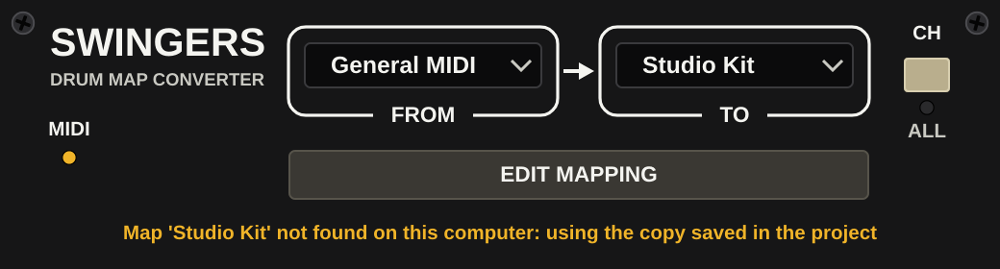
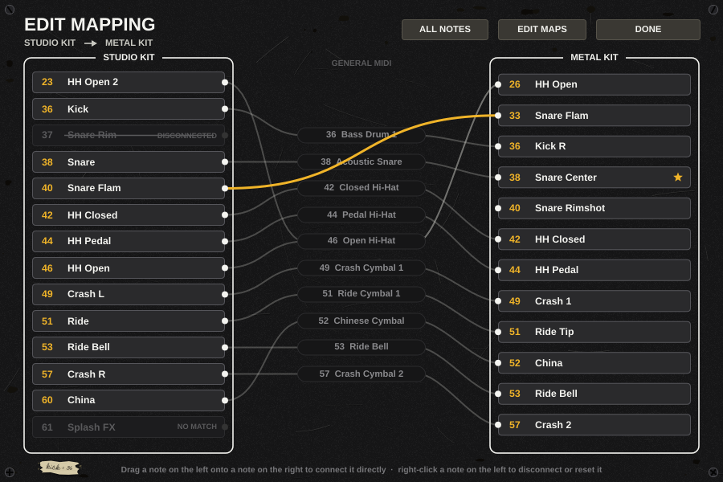
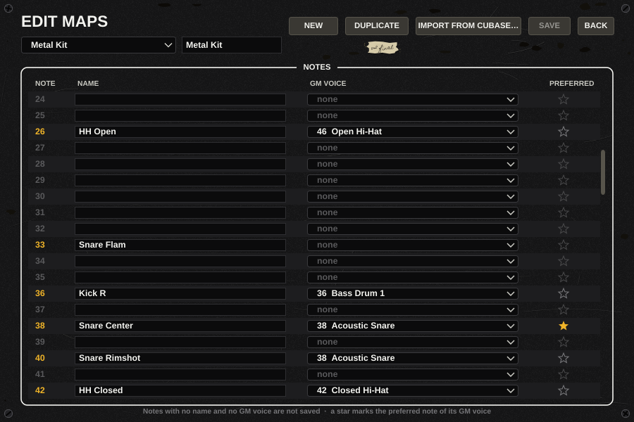
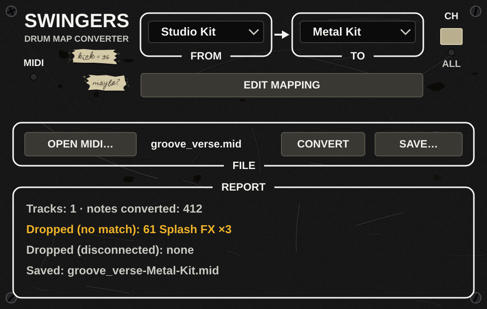

<p align="center">
  
</p>

# Swingers

Swingers converte le parti di batteria MIDI da una drum map a un'altra: un groove scritto per una libreria (per esempio Addictive Drums 2) suona con un'altra (per esempio SDX Metal Foundry) con i pezzi giusti, senza riscrivere le note a mano. Funziona come **plugin MIDI** nel DAW, in tempo reale, e come **applicazione standalone** che apre un file MIDI, lo converte e ne salva uno nuovo. Fa parte di [Sweetspot Tools](https://github.com/sweetspot-tools).

Stato: prima versione, sul branch `juce-rewrite`. Non ancora provata dentro i DAW (vedi [Formati e host](#formati-e-host)).



## Funzioni

- Plugin MIDI (VST3, CLAP, AU MIDI FX su macOS) e standalone, dallo stesso codice.
- Conversione tra due drum map qualsiasi, con il General MIDI come tappa intermedia.
- Eccezioni per coppia di mappe, disegnate a mano in una patchbay.
- Editor delle drum map, con import dalle drum map di Cubase.
- Conversione di file MIDI nello standalone, senza perdita di timing e senza toccare il file originale.
- Canale a scelta (predefinito: tutti); tutto ciò che non è una nota (CC, pitch bend, program change, clock, SysEx) passa intatto.
- Lo stato (mappe scelte, eccezioni in uso, canale) è salvato nel progetto del DAW, con una copia delle mappe usate: il progetto suona uguale anche su un altro computer.

## Come funziona

**Il General MIDI è il pivot.** Ogni drum map dice, una volta sola, a quale voce GM corrisponde ognuna delle sue note (più note possono andare sulla stessa voce: "HH open" e "HH open 2" su GM 46). Conversione A → B: nota di A → voce GM → nota di B che ha quella voce. Con N mappe servono N descrizioni, non N×N tabelle. Se in B più note hanno la stessa voce vince quella segnata come *preferita* (la stella nell'editor), altrimenti la prima per numero di nota.

**Eccezioni per coppia.** Nella patchbay ("Edit mapping") si trascina da una nota di A a una nota di B per collegarle direttamente, scavalcando il GM; si stacca una nota (cavo trascinato nel vuoto, oppure clic destro e *Disconnect*) per scartarla di proposito; clic destro e *Reset* torna al percorso standard. Le eccezioni valgono solo per quella coppia e si salvano in un file creato alla prima eccezione.

**Note scartate.** Una nota di A senza voce GM o senza corrispondente in B viene scartata (note-on e note-off), sempre, senza opzioni. Nella patchbay si vede grigia; lo standalone le elenca nel resoconto.



## Formati e host

| Formato | Piattaforma | Host previsti |
|---|---|---|
| VST3 | Linux, Windows, macOS | Cubase, Reaper, Studio One, Bitwig, FL Studio |
| CLAP | Linux, Windows, macOS | Bitwig, Reaper e gli altri host CLAP |
| AU (MIDI FX) | solo macOS | Logic |
| Standalone | Linux, Windows, macOS | non serve un host |

**Non ancora provato negli host.** Il formato VST3 è validato con il validatore di Steinberg (47 test passati, vedi [Validazione](#validazione)); il caricamento nei DAW elencati, il salvataggio e la riapertura dei progetti non sono stati ancora verificati a mano. CLAP e AU non sono stati validati (`clap-validator` non era disponibile; `auval` esiste solo su macOS).

**Ableton Live non è supportato** in questa versione: non fa uscire il MIDI dai plugin VST3/AU. Servirebbe un dispositivo Max for Live che legga le stesse mappe.

## La cartella `Documents/Swingers`

Mappe ed eccezioni dell'utente stanno in `Documents/Swingers/`, la stessa per plugin e standalone:

```
Documents/Swingers/
  maps/    <id>.swmap.json            una mappa per file
  pairs/   <idA>__<idB>.swpair.json   le eccezioni di una coppia
```

- La mappa General MIDI (note 35-81) è inclusa nel plugin e non si modifica: si duplica.
- Un `id` usa solo `[a-z0-9-]` e il file si chiama esattamente `<id>.swmap.json`; il file di coppia `<idA>__<idB>.swpair.json`. Un file che non rispetta queste regole non viene caricato e viene segnalato nel selettore. Una mappa utente con lo stesso id di una inclusa non la sostituisce mai. Una mappa nuova, duplicata o importata prende l'id al primo salvataggio: il nome in minuscolo con i trattini più quattro cifre esadecimali casuali (es. `studio-kit-7f3a`), mai uno già usato.
- Un file illeggibile non blocca mai l'audio: viene saltato e segnalato. Swingers non sovrascrive mai un file che non è riuscito a caricare.
- Se una mappa scelta nel progetto non c'è più sul computer, o c'è ma è diversa, il plugin usa la copia salvata nel progetto e lo segnala (lo stesso per le eccezioni); per passare alla versione del computer basta sceglierla di nuovo nel selettore From/To.

## Editor delle mappe e import da Cubase

"Edit mapping" apre la patchbay; da lì si apre l'editor delle mappe: tabella delle 128 note con nome, voce GM da menu e stella *preferita*, e i comandi *New*, *Duplicate*, *Import from Cubase*, *Save*. Le modifiche non salvate restano in memoria quando la finestra del plugin si chiude e si ritrovano alla riapertura.

L'import legge l'XML delle drum map di Cubase: nome della mappa e, per ogni voce, nota (`INote`), nome e voce GM proposta (`ONote`). Le voci senza nome, con nome `---` o con `ONote` 0 restano senza voce GM. Tollera gli XML che Cubase produce con `<`, `>` o `&` non escapati nei nomi (per esempio `[Ride ><]`). Crea una mappa nella cartella dell'utente, rivedibile nell'editor.



## Conversione di file (standalone)

Lo standalone aggiunge la barra *Open MIDI → Convert → Save* e un resoconto: tracce toccate, note convertite, note scartate per numero e motivo.

- **Non sovrascrive mai il file d'origine**: rifiuta di salvare sul file aperto (anche attraverso link simbolici o hard link) e propone `<nome>-<MappaArrivo>.mid`.
- **Esatto al tick**: formato del file (0 o 1), risoluzione, tracce ed eventi restano identici; cambiano solo i numeri delle note di nota e di aftertouch polifonico sul canale scelto, e mancano solo le note scartate.
- Se si cambiano mappe, eccezioni o canale dopo la conversione, il risultato in memoria viene invalidato e va rifatto con *Convert*.
- Un file illeggibile o senza note sul canale scelto viene detto nel resoconto e non si salva.



## Compilazione

Richiede CMake 3.22+, Ninja, un compilatore C++20 e le dipendenze di JUCE per la piattaforma (su Linux: ALSA, freetype, X11 e relative librerie di sviluppo; vedi la documentazione di JUCE). Le librerie sono submodule in `vendors/`, fissati: JUCE 8.0.4, Catch2 v3.5.2, clap-juce-extensions.

```bash
git submodule update --init --recursive
cmake -S . -B /tmp/swingers-build -G Ninja -DCMAKE_BUILD_TYPE=Release
cmake --build /tmp/swingers-build -j2 --target Swingers_VST3 Swingers_CLAP Swingers_Standalone
```

Si compila fuori dal repo (la cartella di build è a scelta). I bundle finiscono in `Swingers_artefacts/Release/` dentro la cartella di build, uno per sottocartella: `VST3/Swingers.vst3`, `CLAP/Swingers.clap`, `Standalone/Swingers` (e `AU/Swingers.component` su macOS). Non vengono copiati nelle cartelle dei plugin: si installano a mano (per esempio `~/.vst3` e `~/.clap` su Linux).

## Test

```bash
cmake --build /tmp/swingers-build -j2 --target swingers_tests
ctest --test-dir /tmp/swingers-build --output-on-failure
```

I test coprono motore, file MIDI, import Cubase, libreria delle mappe, stato del plugin e interfaccia (disegno senza schermo). Non provano il comportamento dentro un DAW.

Le immagini in `docs/screenshots/` si rigenerano con `swingers_render` (target fuori dalla build predefinita; vedi l'intestazione di `tools/render_editor.cpp` per le opzioni).

## Validazione

`tools/validate.sh <cartella-artefatti>` esegue i validatori dei formati su una build Release:

```bash
VST3_VALIDATOR=/percorso/del/validator tools/validate.sh /tmp/swingers-build/Swingers_artefacts/Release
```

- VST3: il validatore di Steinberg, se `VST3_VALIDATOR` punta al binario (si costruisce dai sorgenti del VST3 SDK, target `validator`).
- CLAP: `clap-validator validate`, se è nel `PATH`.
- AU: `auval -v aumi Swng Swtl`, solo su macOS (il componente deve essere installato).

Ciò che manca viene saltato con un messaggio; il codice di uscita è diverso da zero se un validatore che è partito fallisce.

## Licenze

Il codice è sotto **AGPL-3.0**, vedi [LICENSE](LICENSE). Le librerie di terzi e le relative licenze sono elencate in [THIRD_PARTY_NOTICES.md](THIRD_PARTY_NOTICES.md).

Il logo Sweetspot Tools in cima a questa pagina viene dal repository [sweetspot-tools/brand](https://github.com/sweetspot-tools/brand) con licenza **CC BY-ND 4.0**: non è coperto dalla AGPL e non è incluso in questo repository (è solo un collegamento).

## Documenti di progetto

- Spec: [docs/superpowers/specs/2026-10-24-swingers-design.md](docs/superpowers/specs/2026-10-24-swingers-design.md)
- Piano: [docs/superpowers/plans/2026-10-24-swingers.md](docs/superpowers/plans/2026-10-24-swingers.md)
- Preview dell'interfaccia: [docs/mockups/swingers_preview.html](docs/mockups/swingers_preview.html)
